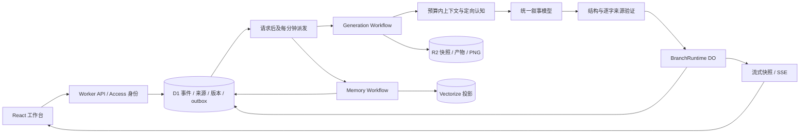

# LightRP V3 架构

本说明对应当前实现。运行层为 Cloudflare Workers、D1、R2、SQLite Durable Objects、Workflows、Vectorize 和 Workers AI/AI Gateway；没有 PostgreSQL、Redis、外部记忆服务或常驻记忆进程。

## 数据作用域与真源

`owner → world → story → branch → session` 是数据组织层次。owner 来自已验证的 Access `sub`（服务凭据使用经过签名验证的 `common_name`），API 不接受客户端指定 owner。session 是分支下的聊天容器；记忆属于故事线和分支，因此同分支的新聊天可以继续前一段剧情。

D1 是事实账本。`turns/events/sources` 保留提交身份、事件顺序、来源版本和 generation；`source_spans` 使用 Unicode code-point offsets 和逐字 quote。记忆在 `memory_versions` 追加不可变 revision，并通过 evidence、dependencies、head 和 cursor 描述当前有效状态。scene 是事件对应的场景投影，包含地点、剧情时间、天气、在场角色和未完成事项。

`canon` 表示有权威来源的世界事实；`belief` 必须指定 observer，表示该角色所信，不代表客观真相。`relation`、`episode`、`observation`、`experience` 和 `procedure` 分别表示关系、情节、压缩观察、执行案例和适用方法。模型提供候选及 quote，服务端按来源决定 authority/confidence，并验证剧情作用域；roleplay 中玩家单方面声称不会直接升级为世界真相。

`knowledge_grants` 授权某角色知道精确原文片段，包含 witnessed/told/rumor/inferred 和明确作者／设定渠道及生效顺序。`knownBy` 是派生提示，不是授权凭证。自动抽取必须提供独立 `knowledge` 获取证明，定位明确角色、获取方式和逐字原句，并覆盖其将读取的全部内容证据；仅在场、未听见、内心、假设、引文中的获取声称不能授权。事实、情节、经历、能力及重建共用同一检查；旧工件没有证明则不制造新 grant。角色召回、来源展开和角色上下文均检查授予片段及撤销；同一消息的公开句子不会授予旁边的导演秘密。导演可以查看所属故事的全部有效来源；角色认知边界是一层叙事约束，用户身份权限仍由 owner 控制。

## 生成提交

1. API 校验角色、session、`expectedHead` 和 `commandId`，在一个 D1 batch 中创建 task 与 generation outbox。同分支同时只接受一个活动任务；重用幂等键但改变输入会失败。
2. Generation Workflow 保存 task 的 attempt/cancel epoch，组装预算内的上下文，固定资料 revision、owner deletion epoch、来源 version/generation 和 branch head。
3. 统一叙事调用产生草稿并通过 DO 发布增量。正文完成后抽取场景、事实、经验、能力和程序使用记录，校验 JSON、合法角色及原文证据；中断或达到输出上限不会提交半个回合。
4. DO 调用 `Store.appendTurn`，D1 原子检查 head、task attempt/cancel epoch、owner epoch 和所有来源 fence，提交输入/正文事件、scene、资料更新与 memory outbox。提交重放返回原事件；正文提交和派生记忆推进是两个可观测阶段。
5. Memory Workflow 写入受控记忆，推进连续 cursor，学习经验，更新观察和向量投影。请求尾部和每分钟 cron 都派发 outbox；稳定 workflow ID 合并重复派发。

可选 Clef 判断在第 3 步确定性校验之后逐候选核验语义证据。它只拒绝或延缓提交，不生成权限；灰区、失败和使用量保留任务审计。模型配置随任务冻结，默认关闭额外判断，设置页可以独立测试并选择 Clef。调用细节与真实合成评测见 [Clef 说明](clef.md)。

作者纠正使用同一 D1 batch 写入 correction 原文、100 权威的记忆 revision、旧版本 supersession、依赖失效、owner epoch 和下一水位的 outbox；head 或 projection 竞争、无效目标和投影插入错误不会留下半个作者事件。

取消更新 D1 状态和 cancel epoch。后台步骤及最终提交都验证 fence；DO 的删除撤销记录阻止迟到流恢复被删除文本，SSE 重连以当前 task attempt/草稿为准。R2 产物写入后再次检查来源和任务状态，失效则补偿删除。失败任务保留有效草稿，可创建新 attempt；取消任务重新提交新 command，不复用旧提交。

## 召回与上下文

当前召回组合 SQLite FTS5 词法、实体/谓词命中、传入的向量候选、有限跳数的关系扩展和近期补尾，使用融合排序。关系扩展限制 seeds、hops、fanout、nodes 和执行时间。Vectorize 只给候选；D1 重新检查 owner、故事、分支前缀、认知者、来源状态、有效时间和当前 revision，再按 token 预算返回可回读证据。

向量 namespace 按 owner/branch 隔离，metadata scope 进一步区分 director 和 character。每个不可变记忆 revision 的 embedding 在 D1 缓存，跨认知者复用；viewer 向量分别建索引。索引 ID 是 memory revision 与完整 scope 的 SHA-256，固定 64 ASCII 字节，符合 [Vectorize ID 限制](https://developers.cloudflare.com/vectorize/platform/limits/)；查询只通过受 owner/branch/viewer/scope 约束的 manifest 反查，不从字符串切割记忆 ID。纠正/失效 revision 从 manifest 和 Vectorize 剔除，来源删除也清理 embedding cache。外部 upsert 与 D1 之间没有分布式事务：实现依靠 epoch guard、写后校验、补偿删除和查询端后验过滤保证旧候选不成为有效召回。

叙事及结构化验证提示词将稳定的规则、绑定资料前置，变化的场景与召回内容后置，以提高直连模型的前缀缓存复用。模型仍处理本轮完整有效上下文；来源校验与删除水位保持原流程。实际 token 命中统计及合成对照见[语言模型缓存说明](./model-cache.md)。

上下文分别分配固定规则/角色、近期原文、观察、召回和世界书预算。核心规则和必要资料放不下时显式失败，超出近期窗口但尚未经过连续整理的事件触发 `MEMORY_BACKLOG`；不会默默跳过整个长会话尾部。角色聚焦影响卡片详细度和定向认知块；director 的事实块与每位角色的已知块分开组装。总提示预算包含最终消息开销。

自动整理使用增量 Observer 与反思压缩器：按认知者和规则、事实历史、认知/经历、剧情纪要四个桶，将旧摘要与全部新增片段逐页合并。原文按事件序号/Unicode 片段位置推进；结构化记忆按数据库 rowid 推进，普通状态变化的历史 revision 会被整理，作者纠正/遗忘/删除的输入会被排除。每页限制处理量而不限制历史总量；迟到的旧事件抽取也会通过新 rowid 再进入整理。角色原文仅使用真实知识授权片段，并注明获知序号，避免把后来获知的信息写成当时已知。经验和方法同时整理结构化条件、步骤、结果和反例；候选、暂停及退出使用的方法也保留状态历史，不作为当前启用方法召回。

每个摘要不超过约 1,800 token，合并内容超过这个阈值时，调用当前配置的辅助模型反思至约 1,000 token。每次反思要求覆盖旧摘要和所有新增输入 ID，校验非空、来源 ID 集合和输出预算，最多修复两次。普通短页通过合并直接提交，不额外调用模型。压缩是语义摘要，不是无损存档；完整事件、原子记忆和逐字来源始终保留并可检索。

导演的剧情纪要优先整理，后台再完成其余桶和角色视角；数据库分页先按权威桶过滤，避免空桶反复扫描无关历史。单条版本准备只读取对应记忆键及必要的能力版本，保留完整依赖授权检查。事实提交遇到同时发生的投影更新时，事务回滚后最多重新准备两次；原始 source fence 和 owner epoch 固定不变，持续冲突或来源失效不会提交或推进水位。

`observation_progress` 分开记录扫描位置、已完成事件前缀、累计处理量和反思次数。新摘要激活与进度在同一个 D1 batch 内完成，检查投影 CAS、进度 CAS、来源、删除 epoch 和输入版本；部分长事件只推进片段位置，不虚报完成水位。旧摘要通过不可变依赖保留完整来源链，逐层检查角色授权，普通摘要替换不会使来源丢失。角色获取/撤销授权、资料绑定或删除 epoch 改变时重新整理合法来源。新分支从其可见前缀重建；父分支后续摘要不会倒灌。

每页读取、准备及激活是独立 Workflow 步骤，运行历史只保存 R2 缓冲 key 和少量状态，来源正文可由删除清理擦除。失败保留上一个已成功激活的摘要及页进度，重试从该页续跑。上下文结合已选摘要和近期原文；超长开篇在成功整理且摘要确实进入本回合上下文后，可以由摘要代替整段原文。必要整理尚未覆盖的原文仍触发等待。来源 fence 使用批量 D1 查询，避免长摘要按每条历史事件单独读取。

实体解析使用独立 ID、来源有效的名字/别名和原文注册。两个同名角色不合并；有歧义的名字和未知 ID 留待消歧，不猜测归属。实体与别名读取同样受故事、分支事件前缀和来源 version/generation 约束。

## 分支、资料与经验

分叉记录事件边界及祖先 lineage，同时冻结父线的记忆、授权、资料绑定和能力水位。孩子继承当时可见的前缀，父线后来的纠正、知情和卡片更新不会倒灌；孩子的纠正也不会改父线。场景从分叉时点恢复，派生重建通过 memory outbox 推进。来源删除属于全局原文删除，影响引用该来源的所有分支，不是只隐藏当前线。

资产保存独立 `raw_json` 与规范化 `data_json`。PATCH 以 expected revision 乐观校验、创建新 revision；PNG 使用新 R2 key，不覆盖上一版本。世界书选择器返回位置、深度、角色、预算、递归轮次和跳过原因。按 seed、书和条目确定概率，传输重试不重抽；整体提示预算高于单书 `ignoreBudget`。绑定资料更新需要显式应用到分支，分叉保留其绑定历史。

经验记录能力、条件、实际步骤、结果和精确证据。方法和条件各自规范化生成 key；重复记同一次执行不能增加独立成功数。只有具备有效能力证据、相同条件/方法至少两次不重叠的 assistant execution 成功、且无未决失败，程序才自动 active。计划、unknown/unfinished 不是成功；方法反例导致 suspended，能力丧失及支持来源失效会使相关程序不可用。用户可手动改变程序状态；每次使用区分 retrieved/planned/applied，并记录实际结果。

## 验证边界

真实 SQLite/D1 测试覆盖事务、来源、分支和经验规则；R2/Vectorize/Workflow 故障测试在外部服务边界注入延迟、删除和重复派发。本地 Playwright 覆盖真实 Worker 和浏览器，但使用明确的 local-demo 模式。8 故事/957 次提交/128 问题包含一条 500 回合主线，是合成检索回放。真实托管生成和后台记忆 smoke 已通过；三方案真实 Qwen 对照已完成 128 题各一次，但严格字符串评分不是人工语义盲评。自动抽取精确率、压缩事实保真及开放回答准确率仍未验收，详见 [评测说明](evaluation.md)。

故事导出包含所有不可变记忆历史、分支 lineage 水位、来源与证据、资料绑定及原始 JSON revision、能力/使用账本、游标、依赖和删除审计；保留原 SQLite rowid，便于解释分叉冻结边界。PNG 只列出 R2 key 和未内嵌状态，任务产物与完整存储备份仍需另行保存。导出末尾检查 owner epoch 和分支版本，若过程中发生删除或剧情/投影变更则返回冲突，请重试。
